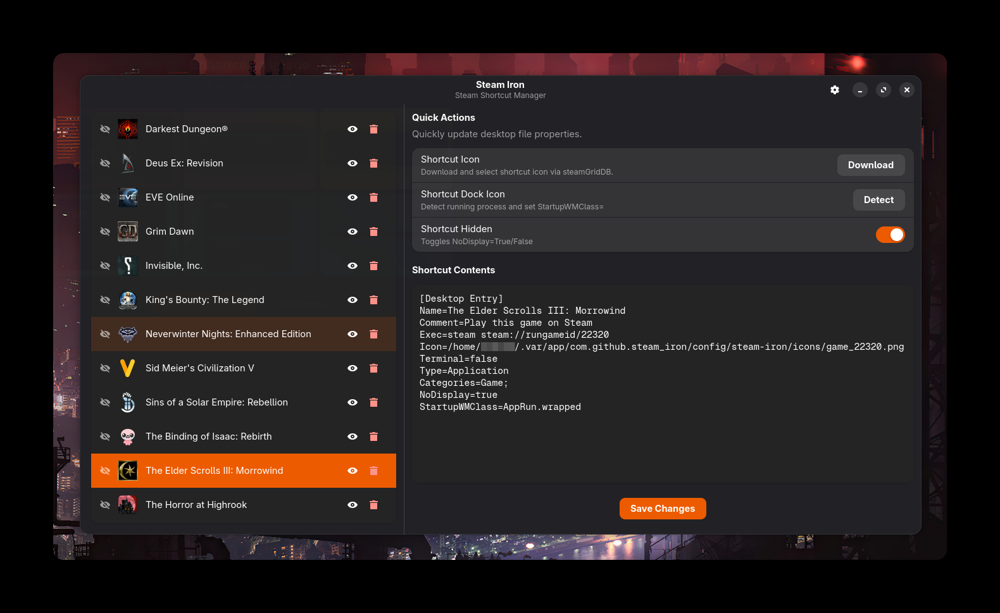

# Steam Iron

A GTK4 / Libadwaita application for GNOME that helps with managing Steam game `.desktop` shortcuts. Hide unwanted shortcuts from the GNOME Shell Application menu, dynamically detect the correct `StartupWMClass` so dock/panel icons match running game windows, and browse/apply custom icons directly via SteamGridDB.

## Features

- **GNOME App Grid Visibility (`NoDisplay`):** Quickly toggle whether a Steam game shortcut appears in your GNOME Shell application launcher.
- **Dynamic `StartupWMClass` Detection:** Scans active game processes to resolve the exact window class GNOME expects—automatically handling both XWayland (`steam_app_<id>`) and native Wayland (`PROTON_ENABLE_WAYLAND=1` names).
- **SteamGridDB Icon Integration:** Search and apply high-resolution game icons directly to your `.desktop` entries without manually downloading files or editing text.

## Screenshots

  
  &nbsp;
  

